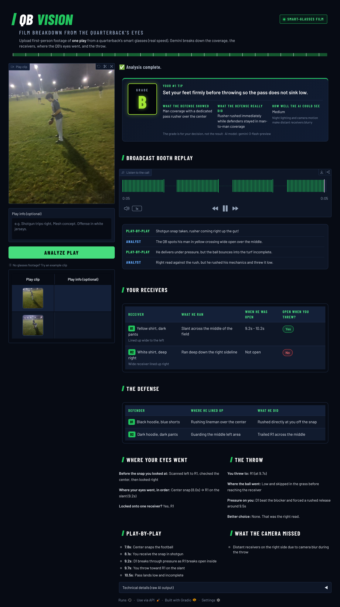

# 🏈 QB Vision

**Film breakdown from the quarterback's eyes.** QB Vision analyzes first-person football
footage from smart glasses worn by a quarterback. Upload one play and AI grades the
decision, shows where the QB's eyes went and who was open, suggests the better choice,
and then two AI announcers call the play like a TV replay.

**[▶ Try the live demo](https://qb-vision.onrender.com)** · **[🎥 Watch the demo video](https://drive.google.com/file/d/1uBoa4ugJOWEYdlcedV-MjxxUlL_Y-Ex9/view?usp=sharing)**



> The live demo runs on a free server that sleeps when idle. The first load can take about a minute.

## Why I built it

I play quarterback, and the film we watch is from a sideline camera that never shows what
I actually saw in the moment. I wanted a way to rewatch a play through my own eyes and get
honest feedback on my reads, not just whether the pass was complete.

## Features

- **Decision grade + #1 tip.** A letter grade for the decision (not the result) and one thing to fix next rep.
- **What the defense showed vs. what it really did.** Coverage before and after the snap, in plain words.
- **Receivers and defense.** When each receiver was open, whether he was open at the throw, and what each defender did.
- **Where your eyes went.** The pre-snap scan, the order the QB looked, and whether he stared down a receiver. Only first-person footage can show this.
- **The throw.** Target, ball placement, pressure, and the better choice.
- **Broadcast booth replay.** A play-by-play voice and an analyst voice call the play, with a transcript.
- **Honest about limits.** A "What the camera missed" list instead of guessing.

## How it works

```
Play clip ──▶ Gemini Files API ──▶ Gemini (video at 4 fps + prompt) ──▶ JSON analysis
                                                                         │
                       ┌─────────────────────────────────────────────────┤
                       ▼                                                 ▼
            Coaching report (Gradio)                     Broadcast script ──▶ ElevenLabs
            grade · tables · timeline                     two voices, stitched into one replay
```

1. **Upload.** The clip goes to the Gemini Files API; the app waits until it is processed.
2. **Analyze.** Gemini watches the video at 4 frames per second (to catch fast route breaks)
   with a prompt that asks for structured JSON: coverage, receivers, defenders, the QB's eyes,
   the throw, a timeline, what it couldn't see, and a two-announcer broadcast script.
   The prompt asks for plain language a player (not a coach) understands.
3. **Stay up when models are busy.** The app ranks the available Gemini models (Pro, then Flash,
   then Flash-Lite) and falls back automatically on overloaded, retired, or quota-limited models,
   with request timeouts and a retry round, so one stuck model can't freeze the demo.
4. **Report.** The JSON is rendered as a readable report: scoreboard grade, tables that turn into
   cards on phones, and a play-by-play timeline.
5. **Broadcast booth.** Each announcer line is voiced by its own ElevenLabs voice and the clips
   are joined into one replay that plays automatically. Without an ElevenLabs key, the transcript
   still shows.

## Built with

- **Python** and **[Gradio](https://www.gradio.app/)** for the web app
- **Google Gemini API** (`google-genai`) for video understanding and structured output
- **ElevenLabs API** for the broadcast booth voices
- **Render** for hosting
- Built with help from **Claude Code**

## Run it locally

```bash
git clone https://github.com/anish-rv07/qb-vision.git
cd qb-vision
pip install -r requirements.txt
cp .env.example .env   # add your GEMINI_API_KEY (and optionally ELEVENLABS_API_KEY)
python app.py          # then open http://127.0.0.1:7860
```

| Variable | Required | What it does |
|---|---|---|
| `GEMINI_API_KEY` | Yes | Gemini key from Google AI Studio |
| `ELEVENLABS_API_KEY` | No | Turns on the broadcast booth voices |
| `GEMINI_MODEL` | No | Force one Gemini model instead of auto-picking |
| `ELEVENLABS_PLAY_BY_PLAY_VOICE` / `ELEVENLABS_ANALYST_VOICE` | No | Use different ElevenLabs voices |

Example clips live in `examples/`; any `.mp4` or `.mov` there shows up as a clickable example.
The analysis prompt is in `analysis_prompt.txt`.

## Deploy

- **Render (free):** New → Blueprint → pick this repo. Render reads `render.yaml` and asks for
  `GEMINI_API_KEY` (and optionally `ELEVENLABS_API_KEY`).
- **Hugging Face Spaces:** create a Gradio Space on ZeroGPU hardware, add the keys as Secrets,
  remove `gradio` from `requirements.txt`, and add Spaces frontmatter (`sdk: gradio`,
  `app_file: app.py`) to the top of this README. The app already includes the placeholder
  function ZeroGPU requires.

## Limitations

- First-person footage only shows what the QB looked at; players off camera are listed under
  "What the camera missed".
- Night or low-light footage lowers confidence, and results can vary a little between runs.
- On the free Gemini tier, models are sometimes busy; the app falls back to other models.

## Author

**Anish Veereddy**
